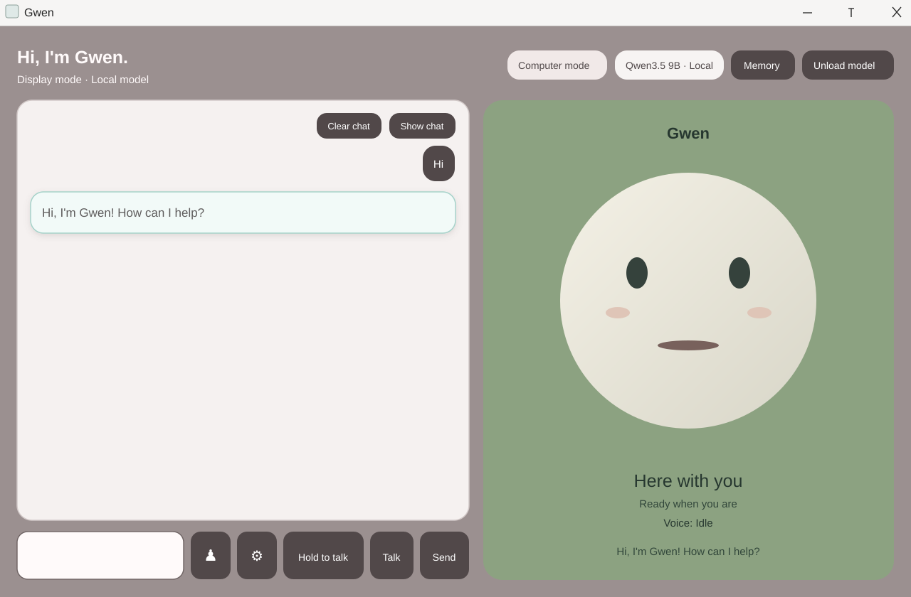

# Gwen — Desktop AI Companion

Gwen is a Windows desktop assistant built with WPF and .NET 10. It runs conversations locally through Ollama and includes a visual companion, voice controls, conversation memory, and optional tools for current information and computer interaction.



## Features

- Local chat using the configured Ollama model, `qwen3.5:9b`.
- Display mode for conversation and Computer mode for supported desktop actions.
- A companion face with animated expressions beside the chat.
- Voice input controls, including push-to-talk, and configurable local speech output.
- Clear the visible chat and restore saved chat with **Show chat**.
- Local conversation history and user-managed preferences in SQLite, with a Memory window for review and deletion.
- Optional live web search through Tavily. Web search needs an API key; ordinary local chat does not.
- Weather lookup and model unload controls.

Computer actions depend on the target application's accessibility support. Review actions in the app before relying on them for important work.

## Requirements

- Windows 11 (WPF desktop application).
- .NET 10 SDK.
- [Ollama for Windows](https://ollama.com/download) with the exact model `qwen3.5:9b` installed.
- Microphone and speakers/headphones for voice features.

## Run locally

Install Ollama, then download the configured model:

```powershell
ollama pull qwen3.5:9b
```

Ollama should be running before you start Gwen. In a terminal, from the project directory:

```powershell
dotnet restore
dotnet build
dotnet run
```

The app uses the local Ollama service; it does not need a paid model API. The model is several gigabytes and uses substantial memory while loaded. Gwen provides an **Unload model** button to release Ollama's active model memory when it is not needed.

## Optional services

### Web search

Live web search is provided by Tavily and requires a Tavily API key. The app reads it from the `TAVILY_API_KEY` Windows user environment variable. Follow [WEB_SEARCH_SETUP.md](WEB_SEARCH_SETUP.md) for setup and provider notes. Search queries and retrieved excerpts are sent to Tavily; summaries are generated by the local Ollama model.

### Natural local speech output

The existing Windows speech fallback works without installing Kokoro. To enable the optional Kokoro ONNX voice, follow [TTS_SETUP.md](TTS_SETUP.md). It requires a separate Python environment and model files; these are not downloaded automatically by the app.

### Voice conversation

See [VOICE_PIPELINE.md](VOICE_PIPELINE.md) for the current voice controls and behavior. Voice processing is intended to run locally, and raw microphone recordings are not saved by default.

## Local data

Conversation history and saved preferences are stored locally in SQLite under `%LOCALAPPDATA%\DesktopAssistant`. Use **Memory** in the app to review saved items or clear stored data. Do not commit local databases, model files, or API keys to source control.

## Tests

Run the conversation behavior checks with:

```powershell
dotnet run --project ConversationBehaviorTests\ConversationBehaviorTests.csproj
```

## Project layout

- `MainWindow.xaml` / `MainWindow.xaml.cs` — WPF interface and application coordination.
- `OllamaChatClient.cs` / `OllamaRuntimeSettings.cs` — local model requests and runtime settings.
- `ComputerModeService.cs` / `LocalToolRegistry.cs` — supported computer controls and local tools.
- `ConversationMemoryStore.cs` / `ConversationContext.cs` — local conversation persistence and bounded context.
- `VoiceService.cs` / `TtsServices.cs` — voice input and speech output.
- `WeatherService.cs` / `WebSearchService.cs` — weather and optional current web information.
- `ConversationBehaviorTests/` — lightweight behavior checks.

## License

No license file is currently included.
